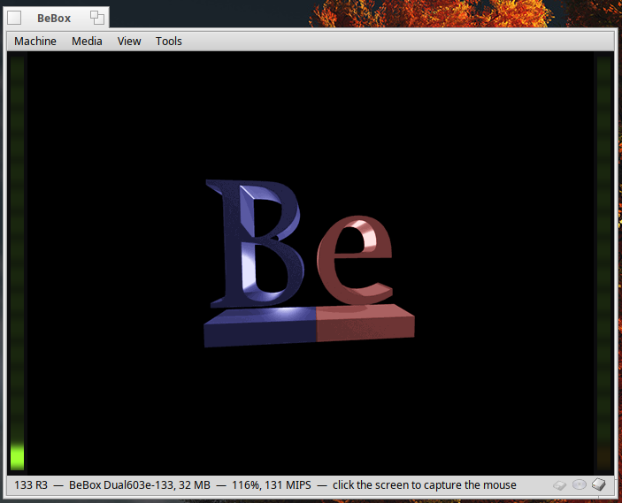
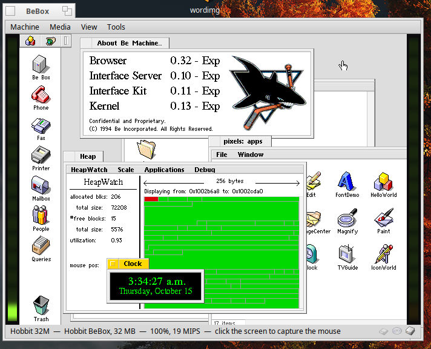
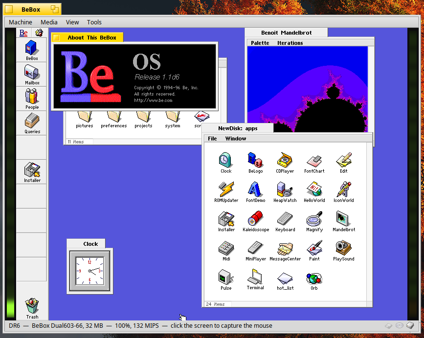
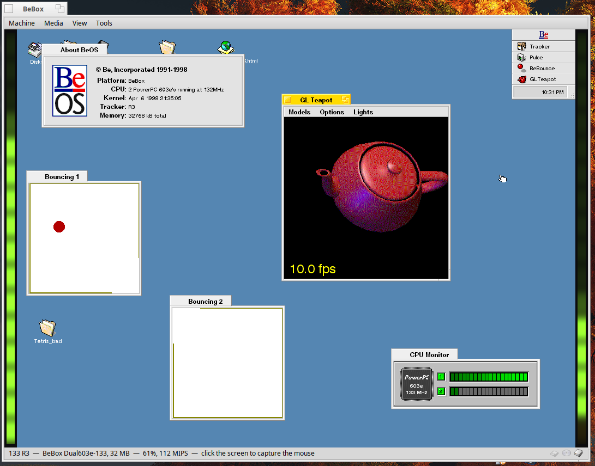
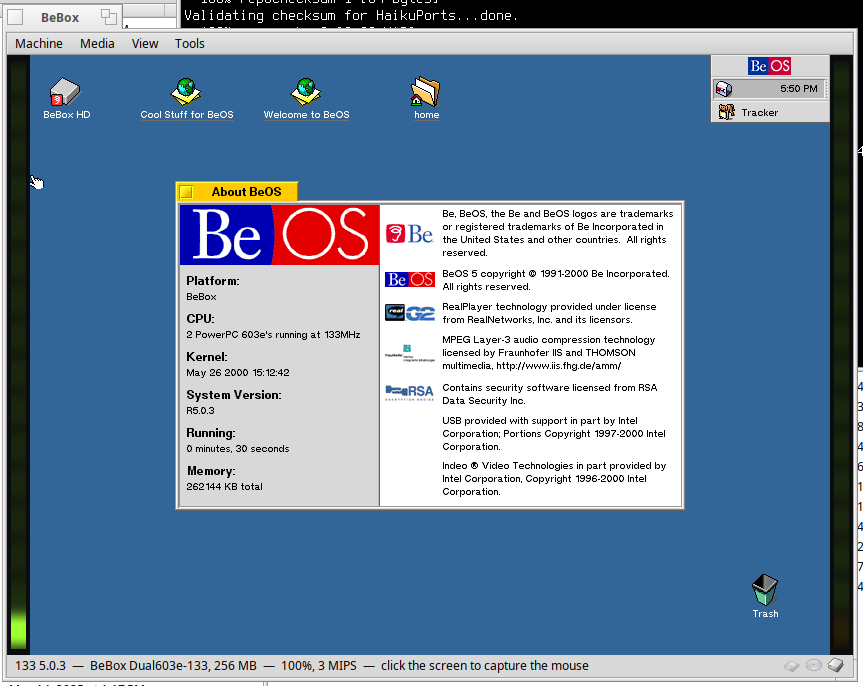
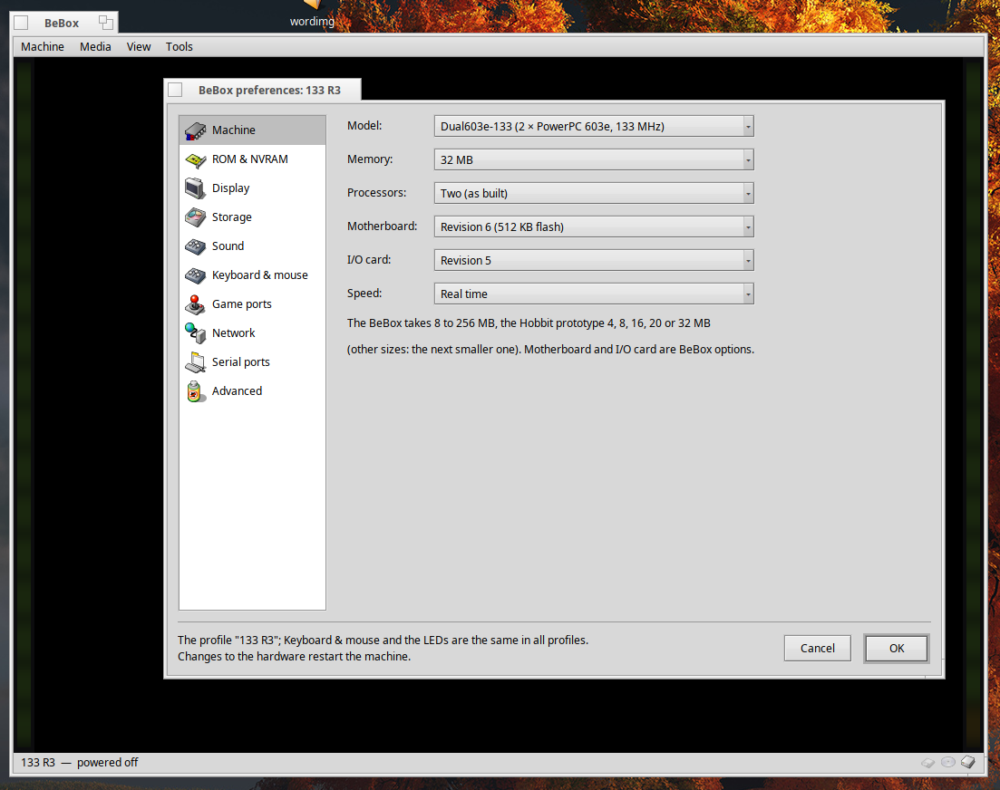

# BeBox
BeBox is a Haiku application that emulates Be Inc.'s BeBox, the
dual-processor computer that BeOS was born on. It runs both PowerPC models
from their original boot ROMs, with BeOS for PowerPC from Developer Release
6 through R5.0.3. It also runs the Hobbit prototypes that came before them,
built around two AT&T Hobbit processors, with Be's 1993-94 system from
their surviving disks.

<p>
  <a href="screenshots/screenshotrom.png"></a>
  <a href="screenshots/screenshothobbit2.png"></a>
  <a href="screenshots/screenshotd6.png"></a>
  <a href="screenshots/screenshotr2.png"></a>
  <a href="screenshots/screenshot503.png"></a>
  <a href="screenshots/screenshotprefs.png"></a>
</p>

| Model | Processors | Bus |
|---|---|---|
| BeBox Dual603-66 | two PowerPC 603 at 66 MHz | 33 MHz |
| BeBox Dual603e-133 | two PowerPC 603e at 133 MHz | 33 MHz |
| Hobbit prototype (1993-94) | two AT&T 92010 (Hobbit) at 25 MHz | BeBus, 25 MHz |

The window shows the emulated screen between the two front panel LED
columns (the "blinkenlights"), sixteen light pipe segments each: a CPU load
bar of fifteen LEDs over the power LED (left) or the disk LED (right), lime
and amber like the real ones (or red and green, if you prefer).

## What is emulated

- Both processors (a PowerPC 603/603e interpreter with the 603's software
  TLB), the MPC105 bridge, the BeBox interrupt and CPU control registers.
- Boot ROM: the nub and main ROM in a writable flash (BeOS's ROM updater
  works), NVRAM and real time clock.
- Video: Number Nine #9 GXE64 (S3 Vision864, AT&T 21C498 RAMDAC) with its
  graphics engine, the default; or Cirrus Logic CL-GD5434. 640x480 to
  1280x1024, 8 and 32 bits per pixel (what the BeOS drivers offer).
- Sound: Crystal CS4231A codec, played through the Haiku media kit.
- AT keyboard and PS/2 mouse; four game ports (axes and buttons).
- Storage: NCR 53C810 SCSI (disks and CD-ROMs on IDs 0-6), IDE, floppy.
- Four serial ports: to a console window, a TCP server or client, a host
  serial port or a log file.
- Ethernet: an NE2000 compatible ISA card on a private network behind the
  host (NAT, through libslirp): the BeBox reaches the host and the
  Internet, and host ports can be forwarded to it.
- Shared folders: a Haiku folder appears to BeOS as a SCSI disk it can read
  and write; the changes come back to the folder when BeOS shuts down.

Not emulated yet: the parallel port, GeekPort, MIDI and infrared ports.

## What you need

- **The BeBox boot ROMs**, which are not included: `bootnub.rom` (16 KB)
  and `bootmain.rom` (Be Boot ROM 1.1d7) from a BeBox, in a folder of your
  choice.
- **BeOS for PowerPC**: CD images (ISO, BIN/CUE or Toast).
- For the releases with the Be File System (Advanced Access to R5): a
  newer boot ROM, which the Preview Release 2, R3 and R4.5 CDs carry as
  `/beos/etc/bebox_bootmain.image` (Advanced Access, Preview Release 1 and
  R5 use one of those). BeBox extracts it for you (see below).

## Getting started

1. Open **Machine > Preferences > ROM & NVRAM** and choose the folder with
   the ROMs. For a BFS release, choose its CD image as **Boot ROM image**:
   BeBox copies the boot ROM from the CD (PR2's also boots Advanced Access
   and PR1).
2. In **Storage**, put the CD image on a SCSI ID as CD-ROM (ID 3 is the
   classic choice), and give another ID a disk for installing: **Choose...**
   opens a file panel whose **New disk image...** button makes one right
   there (in the folder the panel shows) and puts it on that ID.
3. **Machine > Power on**. The newer boot ROMs stop at their boot menu when
   no boot volume is set yet: press Return.

Changes to the hardware restart the machine; a new floppy or CD goes into
the running one. A disk set without a file is turned back into "None" when
the preferences are saved (a CD-ROM drive stays, empty).

## The Hobbit prototype

Before the PowerPC BeBox, Be built its machine around two AT&T 92010
"Hobbit" processors, three AT&T DSP3210 signal processors and the BeBus.
A few prototypes survive with their disks, running Be's 1993-94 system: a
window server, a console, the Browser and its dock.

What is emulated:

- Both Hobbit processors (an interpreter written from AT&T's programmer's
  reference: the stack cache, the MMU, the timers, the event sequences).
- The board: its I/O and interrupt registers, the processor resets, the
  floppy DMA; the PC compatible I/O chips (keyboard and PS/2 mouse, real
  time clock, two serial ports, floppy) and the NCR 53C94 SCSI
  controller.
- The video card: a Trident VGA with an XGA style graphics engine on the
  BeBus (640x480 or 800x600, 256 colors, as the window servers set it).

Not emulated: the three DSPs and what hangs off them (sound, the telephone
and modem), the Ethernet card, the joystick controller and the parallel
port. The system starts without them (its sound server reports an error).

No boot ROM of these machines survives, so BeBox does the boot ROM's job:
it loads `/system/kernel` from the boot volume (the floppy if one is
inserted, else the SCSI disk with the lowest ID) and starts it. To run one:

1. In **Preferences > Machine**, choose **Hobbit prototype** and 4, 8, 16,
   20 or 32 MB of memory (the sizes its kernel knows).
2. In **Storage**, put a Hobbit disk image on a SCSI ID as a disk. To run a
   kernel of your own instead of the disk's, choose it in **ROM & NVRAM >
   Hobbit kernel**.
3. **Machine > Power on**. The kernel reports its progress on serial port
   1 (give it a console window in **Serial** to watch).

Notes:

- The November 1994 disks start `/system/Browser`, which they have as
  `/system/browser`: the console comes up instead (the real machines did
  the same). Type `/system/browser &` in it to start the Browser.
- The floppy drive is the kernel's drive 1.
- The system writes to its disk (swap files and more): keep a copy of
  your images, or use them through QCOW2 overlays
  (`bebox-img create -b IMAGE OVERLAY.qcow2`).
- The front panel lights are hidden: the Hobbit's kernel drives none.

### Installing from the floppies

The installer floppy and disks 1of7 to 7of7 install the November 1994
system (the one on the "pixels" disk) on a new disk. The installer floppy
has no window of its own: its `/system/Browser` copies a minimal system
(kernel, servers, shell, `/Installer`) from the floppy to the first hard
disk, without asking and without showing anything but the pointer. Boot it
only with the disk to install on: it replaces the system files of any
other Hobbit disk it finds.

1. Put a copy of a Hobbit disk (or an overlay of one) on SCSI ID 0, and a
   new disk image on ID 1 (in **Storage**, the ID's file panel has **New
   disk image...**; 120 MB works, the original disks have 120 to 170 MB).
   Power on, type `/bin/format` in the console, choose the SCSI disk with
   ID 1, give the volume a name, then 0 to leave. Power off.
2. Take the Hobbit disk off ID 0 and put the new disk there instead.
   Insert the installer floppy and power on. After about a minute (the
   pointer is all you see), power off and eject the floppy.
3. Power on: the console comes up from the new disk. Type `/Installer`,
   click **Begin**, then insert 1of7 (**Media > Insert floppy...**) and
   click **Continue**, and so on up to 7of7. The Installer then
   uncompresses, verifies and extracts the archive (a few minutes), and
   **Install** finishes: "Installation complete". When it starts
   uncompressing, the console shows `VOLUME:/_install_/archive.Z: System
   Error 0`: harmless, and a real Hobbit did the same (`compress` deletes
   the archive while it still has it open, which this file system
   refuses; the Installer removes it at the end).
4. Restart, and type `/system/browser &` to start the Browser.
5. Optionally, run `/Installer` again with `update.img` as disk #1: Be's
   update of 28 November 1994 (a fixed `storage_server` and the Phone
   answering machine's spoken prompts in `/system/phone`, as on the "be"
   disk).

## Profiles

Each release likes a machine of its own (its boot ROM, its disks, maybe
the 133 MHz model), so the machine is kept in a **profile**: everything in
the preferences except Keyboard & mouse and the LED look, plus the boot
ROM flash (with the boot ROM updates BeOS installs) and the NVRAM (with
the boot volume). **Machine > Profile** lists the profiles to switch
between (a running BeBox restarts with the other one), and has **New
profile...** (a copy of the current profile, under a name like "BeOS5 133
MHz" or "DR8 66 32 MB"), **Rename** and **Delete**. The status line shows
the current profile. Profiles are folders in
`~/config/settings/BeBox/Profiles/`; the settings from before profiles
became the profile "Default".

| Release | Boot ROM | Boots from CD | Installs to disk |
|---|---|---|---|
| DR6 (BeOS 1.1d6) | original 1.1d7 | yes | yes |
| DR7 (BeOS 1.1d7) | original 1.1d7 | yes | yes |
| DR8 | original 1.1d7 | yes | yes |
| Advanced Access | PR2's | yes | yes |
| Preview Release 1 | PR2's | yes | - |
| Preview Release 2 | from its CD | yes | yes |
| R3 | from its CD | yes | yes |
| R4 | from its CD | yes | yes |
| R4.5 | from its CD | yes | yes |
| R5.0.3 | R3's | yes | yes |

"-" means not tried yet. The DR8.2 image is a Mac updater. The boot ROM
from the R3 CD works with every release tested here, so one profile with
it can run them all.

DR6 predates the 1.1d7 boot ROM: BeBox hands its kernel the PCI device
table in the older format it expects. Install it as the CD says: boot the
CD, run the Installer from the dock, format the SCSI disk ("Format:" in the
left pop-up menu), then install onto it and make it the startup disk.
DR6's mouse driver moves the pointer twice as far left and down as right
and up (that is DR6, not the emulation). The Developer Releases' `date`
prints the year as years since 1900 (126 for 2026).

The BeBox takes 8 to 512 MB of memory (**Preferences > Machine**). Be's
FAQ promised up to 1 GB with 64 and 128 MB SIMMs, though Be only tested
32 MB SIMMs; the boot ROM's memory test accepts 512 MB at most (it turns
off every 128 MB bank but the first, so 1 GB would show up as 128 MB). R3
and R4.5 see and use all 512 MB. DR8 boots with up to 96 MB: from 128 MB
on its kernel stops at "swap_file_offset: should never happen". At the
other end, DR8, R3 and R4.5 all run in 8 MB (a pair of 4 MB SIMMs), but
the R4.5 boot ROM does not: it puts its heap at half the memory, which
with 8 MB is right on top of its own code, so it crashes before loading
anything. Boot R4.5 in 8 MB with the R3 boot ROM. The memory test at
power on takes 2 s per 32 MB on the 66 MHz model (32 s with 512 MB) and
half as long on the 133 MHz one.

## Using it

- While the window is active, the keyboard belongs to the BeBox. Click the
  screen to capture the mouse; the host key, **right Control**, releases
  it. **Keyboard & mouse** in the preferences picks another host key and
  sets the mouse speed.
- **Game ports** in the preferences connects host joysticks to the four
  sticks (two per game port, as with Y cables).
- The status line shows the floppy, CD and hard disk (with the disk
  activity); click the floppy or the CD to insert one.
- When a disk image cannot be written (a full disk, say; BeOS then gets a
  write error) or the profile's flash and NVRAM cannot be saved, BeBox
  says so in an alert and for a while in the status line.
- **Media** inserts and ejects floppies and CDs while the machine runs
  (for a CD, give a SCSI ID a CD-ROM drive in **Preferences > Storage**;
  it may be left empty). BeOS mounts a CD by itself a few seconds after
  it goes in. A CD that replaces another one stays out for six seconds
  first: BeOS checks the drive every five seconds and only notices the new
  disc after it has seen the drive empty. A CD that BeOS ejects (CDPlayer's
  Eject button, `eject`) leaves the drive empty.
- **Machine** has the power, reset and interrupt switches, and restarts with
  the boot menu or with kernel debug output on serial port 4 (that holds
  F1 at power on, as on a real BeBox, until the boot ROM starts writing to
  serial port 4). **Send Ctrl+Alt+Delete** gives BeOS
  the keys Haiku keeps for itself: BeOS R3 and later show their Team
  Monitor, and restart when it is sent again.
- The two processors run on two host cores when both are busy
  (**Preferences > Advanced**, on by default): up to nearly twice as fast,
  which the 133 MHz model needs on slower computers. While other programs
  keep the computer's cores busy, two cores are slower than one (each
  processor keeps waiting for the other), so BeBox then runs both on one
  core and tries two again every few seconds. The status line shows the
  speed in percent of a real BeBox.
- **Speed** (**Preferences > Machine**) is the processors' speed: 50%,
  100% (a real BeBox), 200% or as fast as the computer allows. BeOS's
  clock, the cursor's blinking and the keyboard's repeat keep real time
  also with faster processors. When the computer cannot keep up, faster
  processors give back their extra speed first; at a real BeBox's speed
  the whole machine runs slower for a moment and catches up (the sound
  output then keeps more in reserve).
- **Tools > Serial console** shows a serial port connected to a console.
- **View** shows the screen at actual or double size or fitted to the
  window, and shows or hides the LEDs. **Full screen** (or the host key
  with F, also while the BeBox runs) leaves only the screen, and the LEDs
  at the sides if they are shown; the host key with F again brings the
  window back. **Full screen scaling** makes the screen fill the display
  in its proportions (smoothly scaled), or keeps its pixels sharp: the
  largest whole multiple that fits, or actual size (1:1), with black
  around it.

## Network

In **Preferences > Network**, turn on the Ethernet card (port 300h, IRQ 5
by default, as Be's software expects). In BeOS's Network preferences, add a
"Novell NE2000 compatible adapter (ISA)" with the same port and IRQ, and
choose DHCP (R4.5) or set IP 10.0.2.15, mask 255.255.255.0, gateway
10.0.2.2 and DNS 10.0.2.3 by hand. The host is 10.0.2.2 from the BeBox.
**Forwarded host ports** (`tcp:2121:21, tcp:2323:23`) make services
running in BeOS reachable from the host.

## Shared folders

In **Preferences > Storage**, make a SCSI ID a **Shared folder** and choose
a Haiku folder. At power on BeBox copies the folder, with its attributes
(file types, icons), to a fresh BFS volume that BeOS mounts like any disk;
the releases with BFS (Advanced Access and later) can use it. When BeOS has
shut down (Be menu > Shut Down) and the BeBox is powered off, BeOS's changes
go back to the folder: new and changed files, attributes, deletions. A file
changed on both sides meanwhile keeps the Haiku version, and BeOS's is saved
next to it as "NAME (BeBox)". If BeOS did not shut down cleanly, the volume
is kept and given back to BeOS at the next power on, so that it can repair
it first. The same happens when a change cannot be made (a file the folder
refuses, a damaged volume): BeBox says so, deletes nothing in the folder
and tries again at the next power on. As the whole folder is copied at every power on, keep it small:
the BeBox starts once the copy is done (the status line says so meanwhile,
and the window stays usable), and quitting waits for BeOS's changes to be
back in the folder.

## Disk images

Hard disks are raw images or QCOW2 images, which only take the space that
is written (thin provisioning) and can be overlays of a backing image.
`bebox-img` manages them, and reads files from BeOS volumes (BFS) and from
the Hobbit prototypes' disks:

```
bebox-img create [-f raw|qcow2] [-b BACKING] FILE SIZE
bebox-img info FILE
bebox-img check FILE
bebox-img convert [-O raw|qcow2] SOURCE DESTINATION
bebox-img ls IMAGE [PATH]
bebox-img attr IMAGE PATH
bebox-img extract IMAGE PATH OUTPUT
```

For example
`bebox-img extract "BeOS Release 3 PowerPC.iso" /beos/etc/bebox_bootmain.image r3.rom`.

On a Hobbit disk, `extract` also copies whole directories (`/` for the
whole disk) into a new folder, keeping the files' dates, and `ls` shows
the files' types and creators: `bebox-img extract hobbit-930800009.img /
pixels`. No BeOS release reads the Hobbit's file system (DR6 to DR8 have
a later, incompatible version of it, the others BFS), so this is the way
to its files: extract them, then give the folder to a BFS release as a
[shared folder](#shared-folders). The Hobbit's programs do not run on the
PowerPC; its sources, headers, text and pictures are what is useful.

## Scripting

The machine window answers `hey`:

```
hey BeBox get Running of Window BeBox          # also set ... to true/false
hey BeBox get Speed of Window BeBox            # percent of a real BeBox
hey BeBox get LedLevels of Window BeBox        # left, right (0-15)
hey BeBox get SerialLog 4 of Window BeBox      # a console port's output
hey BeBox set Floppy of Window BeBox to /path/disk.img
hey BeBox set CdRom of Window BeBox to /path/disc.iso   # "" ejects
hey BeBox set FullScreen of Window BeBox to true
hey BeBox type of Window BeBox with text=ls    # types on the keyboard
hey BeBox shot of Window BeBox with path=/tmp/screen.png
```

`CdRom` is the first CD-ROM drive, `CdRom 3` the one on SCSI ID 3.
Also `get Mips`, `get EmulatedTime`, `get DiskLed`, `get AudioStats` (the
sound output's counters: underruns are gaps), `get Problem` (the latest
storage problem, empty if none), `get Profiles`, `get Profile`
and `set Profile` (switches, restarting a running machine), and the
commands
`pwon`, `pwof`, `rset` and `cadl` (Ctrl+Alt+Delete). Replies come after the
action.

## Command line

`BeBox [--profile NAME] [--rom-dir DIR] [--boot-rom IMAGE]
[--model 66|133|hobbit] [--kernel FILE] [--ram MB] [--video s3|cirrus]
[--scsiN-disk FILE]
[--scsiN-cd FILE] [--scsiN-share FOLDER] [--ide0 FILE] [--floppy FILE]
[--net] [--net-forward SPEC] [--power-on] [--log CATEGORY=LEVEL]` sets up
the machine (the settings are kept; an empty FILE removes the device, or
leaves the CD-ROM drive empty). `--profile` switches to a profile first,
making it as a copy of the current one if there is none; the other options
change that profile. `--log` writes the emulator's messages of a category
(`scsi`, `machine`, ... or `all`) from that level on (`error`, `warning`,
`info`, `debug`, `trace`) to the standard error, for a start from
Terminal.

`bebox-headless` runs a machine without a window, for tests and debugging:
serial ports to files or TCP, scripted keys and mouse clicks, screenshots,
instruction traces, memory dumps and watches. `bebox-headless --help` lists
the options.

## Building

On Haiku (with `haiku_devel`, `zlib_devel` and `libslirp_devel`): `make`
builds the app;
`package/build-package.sh` builds the app and the tools and creates the
package.

The emulator core is portable C++17 and is tested on Linux:

- `make -C tests/linux check`: processor tests (against `qemu-ppc` as an
  oracle), Hobbit processor tests, multiprocessor and device tests, QCOW2
  tests (against `qemu-img`, also on a full disk), under AddressSanitizer
  and UndefinedBehaviorSanitizer.
- `tests/tsan.sh`: the threaded mode under ThreadSanitizer (the
  multiprocessor test and an R4.5 boot).
- `tests/boot-regression.sh`: boots each BeOS release headless (the media
  and installed disks go in `work/`) and the Hobbit disks (in `Hobbit/`),
  through throwaway overlays.
- `tests/vm-test.sh user@haiku-host`: builds the app on a Haiku machine and
  drives it with `hey`.

`design/` describes the hardware and the emulator's design.

## Authors

- Claude Opus 5.5
- John Rash

## License

MIT, see `LICENSE`. The application icon (`artwork/BeBox.hvif`) is by
zuMi, under the MIT License. The icons in `artwork/icons` come from Haiku's
icon set (MIT, Haiku, Inc.). The BeBox ROMs and BeOS are not part of this
project.
